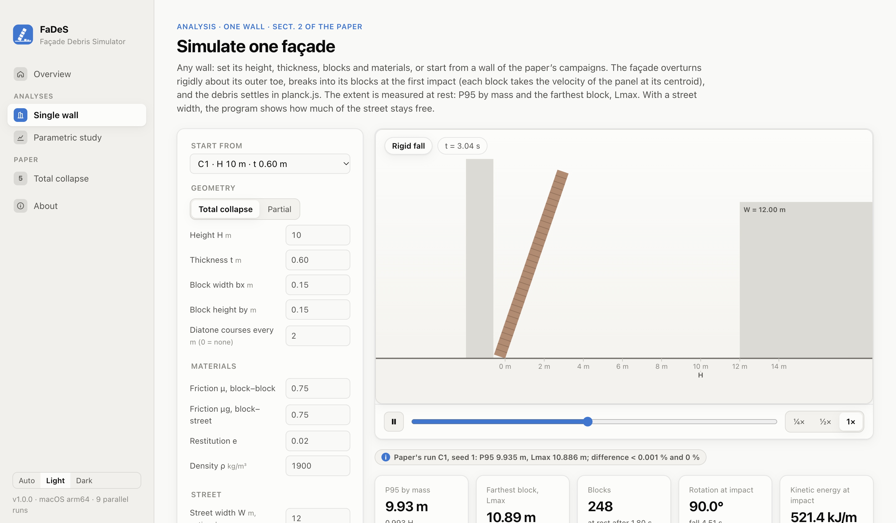
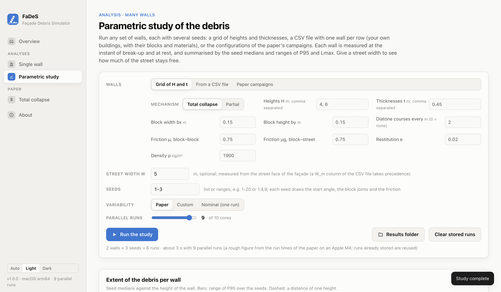

# FaDeS – Façade Debris Simulator

FaDeS simulates the out-of-plane overturning of a masonry façade and the debris it leaves on the street. It is a
two-dimensional rigid-block model:

1. the façade overturns about its outer toe (or about the top of the wall below it, in a partial collapse);
2. it breaks into its blocks at the first impact;
3. the blocks slide and tumble until they stop.

The extent of the debris is measured on the blocks at rest. It works for any wall given by its height, thickness,
block size, diatone courses and materials, in total or partial collapse. It reports how far the debris reaches and,
for a street of given width, how much of the street stays free.

FaDeS is the simulator of the paper *Simulating the debris of overturning masonry façades with rigid blocks: from the
falling panel to the documented collapses* (C. Olivieri, G. Vaiano, L. Sibille, G. Mochi, F. Fabbrocino), and it
reproduces the paper's analyses.



## What it does

- **Single wall.** Any façade, of your own size, blocks and materials, or one from the paper's campaigns. You can
  watch it fall. The program measures P95 by mass and Lmax and plots the cumulative mass and the profile of the debris.
  With a street width it also gives the width left free.
- **Parametric study.** Many walls, each with many seeds. The walls can be:
  - a grid of heights and thicknesses with shared blocks and materials;
  - a CSV file with one wall per row (your own buildings);
  - the configurations of the paper's campaigns.

  For each wall it gives the extent at break-up and at rest, as seed medians and ranges. With a street width it adds
  the width left free, the number of seeds whose debris reaches the far side, and the height of the debris there.
- **The paper, Section 5 (Fig. 7).** The 48 total-collapse configurations of campaigns C1 and C2, 20 seeds each. Until
  you run anything, the values shown are computed from the paper's stored runs.

A wall that coincides with a configuration of the paper's campaigns, with the paper's seeds, is run with exactly the
campaign's parameters and compared with the paper's stored run. The other analyses of the paper (rigid phase,
integrity during the fall, partial collapse, documented collapses, verification) are in preparation.

Results are exported as CSV or JSON, and charts as SVG or PNG.



## Input

Every parameter can be changed. The defaults are the values of the paper's campaigns.

| parameter | meaning | default |
|---|---|---|
| H | height of the façade, m | |
| mechanism, Hr | total collapse, or partial collapse of the top Hr metres | total |
| t | thickness of the wall, m | |
| bx × by | block size across the thickness × along the height, m | 0.15 × 0.15 |
| diatone spacing | through-stone courses 0.20 m high every … m; 0 = none | 2 |
| μ, μg | Coulomb friction between blocks, and against the street | 0.75, 0.75 |
| e | coefficient of restitution of every contact | 0.02 |
| ρ | density, kg/m³ | 1900 |
| variability | sd of the start angle, of the block joints and of the friction | 0.2°, 10 %, 5 % |
| seeds | each seed draws the start angle, the block joints and the friction | 1–20 |
| W | width of the street, m (optional) | |

## Scope of the model

The model is a vertical strip of façade, one metre long, without return walls or floors. The building behind it is a
rigid backstop. The wall starts from rest just past its tipping angle, and there is no ground motion during the fall.
It stays rigid until its first impact and breaks completely into its blocks at that instant.

The paper describes the model and how it was tested:

- The overturning phase is verified to rounding error.
- A masonry panel with little or no tensile strength would crack before landing.
- In total collapse the extent is largely set at break-up: 95 % of the mass lies within about one height when the panel
  lands.
- The convergence and engine tests pass in seven tall, slender walls, which verifies the break-up geometry. The debris
  phase itself, and partial collapse, do not pass the convergence test.

The extent computed for a wall is therefore a property of the rigid-block idealisation, to be read with these results.
It is neither a prediction for a real wall nor an established bound on it. [docs/MODEL.md](docs/MODEL.md) describes the
model in more detail.

## Installing

Installers are attached to the [releases](https://github.com/colivieri89/FaDeS/releases) of this repository:

- **macOS**: `FaDeS-<version>-arm64.dmg` for Apple Silicon, `FaDeS-<version>.dmg` for Intel.
- **Windows**: `FaDeS-Setup-<version>.exe`.

The installers are not signed with a developer certificate, so the system asks for confirmation the first time:

- **macOS**: if the program does not open, go to *System Settings → Privacy & Security* and choose *Open Anyway*.
- **Windows**: SmartScreen shows *Windows protected your PC*; choose *More info → Run anyway*.

## Running from the source code

You need [Node.js](https://nodejs.org) 24.

```sh
npm ci          # install the dependencies (planck.js, Electron, electron-builder)
npm start       # open the program
npm test        # tests
```

Everything also runs from the command line, without the interface:

```sh
# one wall: a partial collapse of the top 4 m of a 12 m façade, larger blocks, a street 5 m wide
node src/cli/cli.js run --H 12 --t 0.45 --mechanism partial --Hr 4 --bx 0.25 --by 0.12 --W 5 --seed 1

# many walls: every combination of three heights and two thicknesses, 20 seeds, a street 6 m wide
node src/cli/cli.js study --H 6,9,12 --t 0.45,0.60 --seeds 1-20 --W 6

# your own walls, one per row of a CSV file
node src/cli/cli.js study --walls my_walls.csv --seeds 1-20

# the paper
node src/cli/cli.js paper                                              # Sect. 5 values from the stored runs
node src/cli/cli.js total --campaigns C1 --heights 5,10 --seeds 1-20   # part of the Sect. 5 study

node src/cli/cli.js --help
```

Every finished run is stored as soon as it ends, so a stopped study resumes where it stopped.

## Walls from a CSV file

One wall per row, comma or semicolon separated. A template with two example walls is in
`reference/walls_template.csv`.

| column | meaning |
|---|---|
| `id` | name of the wall |
| `mechanism` | `T` total collapse; `P` partial collapse of the top `Hr_m` metres; `P1`, `P2`: partial with Hr = H/3, 2H/3 |
| `H_m`, `t_m` | height and thickness, m |
| `Hr_m` | height of the overturning part (partial collapse), m |
| `bx_m`, `by_m` | block size, m (optional) |
| `diatone_step_m` | spacing of the diatone courses, m; 0 = none (optional) |
| `mu`, `muG`, `e`, `rho` | friction, restitution, density (optional) |
| `W_m` | street width, m (optional) |

Empty optional cells take the values of the paper's campaigns.

## Building the installers

```sh
npm run dist:mac    # dist/*.dmg (on a Mac)
npm run dist:win    # dist/*.exe (on Windows)
```

The tests run on Linux, Windows and macOS at every push (`.github/workflows/tests.yml`). The installers are built by
`.github/workflows/build.yml`. It is started by hand from the Actions tab, or by a tag such as `v1.0.0`, which also
publishes the installers as a release.

## Agreement with the paper

The paper's 1920 runs (campaigns C1–C4, seeds 1–20) are stored in `reference/`. Runs made with the program use the
same code, parameters and random draws.

Agreement to the last bit cannot be guaranteed on every computer. The trajectory of thousands of contacts depends on
the last bit of `sin`, `cos`, `atan2` and `log`, and these are not rounded identically by every JavaScript runtime and
processor. The program therefore carries its own implementation of these functions, so that every computer gives the
same result. Against the paper:

- most runs are identical;
- in the others, P95 differs by less than 0.1 % and Lmax by less than 0.5 %.

On Apple Silicon with Node.js 24, the command line with `--native-math` reproduces the stored runs bit for bit.

## Data

The program ships no field data. Documented collapses can be loaded from a CSV file in the format above.

## Code layout

| folder | content |
|---|---|
| `src/sim` | the simulator: rigid phase, break-up, debris phase in planck.js, measures, deterministic functions |
| `src/analyses` | studies of any set of walls, the campaigns of the paper and the summaries of its sections |
| `src/runner` | parallel and resumable execution on worker threads |
| `src/main`, `src/renderer` | the desktop interface (Electron) |
| `src/cli` | the command line |
| `reference` | the stored runs of the paper, the template of the CSV file of walls |
| `test` | tests |

## Citation

If you use FaDeS, please cite the paper (the full reference will be added on publication). The software itself is
cited from `CITATION.cff` (on GitHub: *Cite this repository*).

## Licence

MIT; see [LICENSE](LICENSE). `src/sim/detmath.js` is a translation of fdlibm, © Sun Microsystems, distributed with its
notice, which is kept in LICENSE. planck.js is distributed under the MIT licence.
